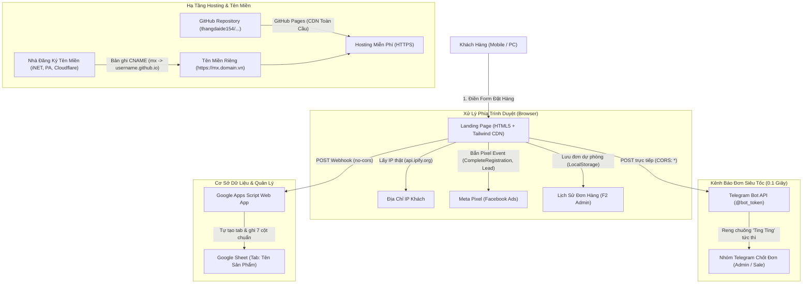

# Quy Trình Đóng Gói Chuẩn: Hệ Thống Landing Page Bán Hàng Ads & Tự Động Hóa Đơn Hàng

Bộ cẩm nang và khung chuẩn kỹ thuật (Framework) hoàn chỉnh để xây dựng trang Landing Page bán lẻ tối ưu tỷ lệ chuyển đổi (CR) cho Facebook Ads / TikTok Ads, tự động ghi nhận đơn vào Google Sheet và bắn thông báo chuông điện thoại tức thì qua Telegram.

---

## 🏗️ Kiến Trúc Hệ Thống (Architecture Flow)



---

## 📌 5 Trụ Cột Kỹ Thuật Bắt Buộc Của Hệ Thống

### Trụ Cột 1: Landing Page Tối Ưu Tỷ Lệ Chuyển Đổi (High-Converting UI/UX)
1. **Công nghệ:** Đơn tệp `index.html` thuần túy + **Tailwind CSS CDN** + Font Inter/Be Vietnam Pro. Tốc độ tải trang < 1.0s, thân thiện 100% với thiết bị di động (Mobile-First 90% traffic Ads).
2. **Cấu trúc nội dung chuẩn Ecommerce Việt Nam:**
   - **Hero Section:** Tiêu đề giật tít đánh trúng nỗi đau khách hàng + Huy hiệu uy tín (Chính hãng, Đổi trả 30 ngày, Bảo hành 12 tháng, Giao toàn quốc).
   - **Flash Sale Banner:** Đồng hồ đếm ngược (Countdown timer) tạo khan hiếm tâm lý.
   - **Bảng Giá Rút Gọn (Compact Pricing):** Các dòng giá Flash Sale rõ ràng kèm % giảm giá. Bấm chọn size tự động cuộn mượt xuống Form đặt hàng.
   - **Proof & Gallery:** Hình ảnh thực tế tỷ lệ 1:1, ảnh phóng to cận cảnh, Video demo trải nghiệm thực tế.
   - **Size Guide (Hướng Dẫn Chọn Kích Thước):** Infographic trực quan + bảng tra cứu đường kính bàn ăn vs đường kính mâm/sản phẩm.
   - **Review Khách Hàng (Social Proof):** 5 sao, hình ảnh bàn ăn thực tế khách gửi, kèm Popup ảo ngẫu nhiên mỗi 7 giây ("*Chị Thảo vừa đặt mâm 80cm...*").
   - **Chính Sách Bán Hàng Rõ Ràng:** Đồng kiểm khi nhận hàng, tem bảo hành điện tử, đổi mới 1-1 trong 30 ngày nếu lỗi.

3. **Form Đặt Hàng Chuẩn:**
   - Các trường bắt buộc: `Họ và tên`, `Số điện thoại` (bắt buộc dạng số), `Địa chỉ nhận hàng`, `Chọn Size / Phân loại` (dạng Card bấm chọn trực quan), `Ghi chú`.
   - **Tự động nhận diện IP Khách Hàng:** Gọi ngầm `https://api.ipify.org?format=json` (dự phòng `https://ipapi.co/json/`) để lưu IP thật, chống boom hàng và click ảo.
   - **Admin Modal Bí Mật (Phím F2):** Giấu nút Admin khỏi mắt khách hàng. Chỉ chủ shop bấm phím `F2` để mở:
     - Xem danh sách khách đã đặt ngay trên trình duyệt.
     - Nút **Xuất Excel (.CSV)** 1-click có dấu tiếng Việt UTF-8 BOM.
     - Ô đổi link Google Sheet Web App & đổi Meta Pixel ID không cần sửa code.

---

### Trụ Cột 2: Bắn Thông Báo Tức Thì Về Telegram (0.1 Giây - Không Phụ Thuộc Bên Thứ 3)
* **Bản chất:** Telegram Bot API hỗ trợ `Access-Control-Allow-Origin: *`. Do đó trình duyệt có thể `fetch` trực tiếp tới Telegram mà không bị lỗi CORS, không lo bị Zalo kiểm duyệt hay khóa nick.
* **Cấu hình trực tiếp trong JavaScript của Landing Page:**
```javascript
const TELEGRAM_BOT_TOKEN = "ĐIỀN_BOT_TOKEN_VÀO_ĐÂY"; // VD: 8947219302:AAFAFKlSny...
const TELEGRAM_CHAT_ID   = "ĐIỀN_CHAT_ID_VÀO_ĐÂY";   // VD: -5440398762

function sendDirectToTelegram(order) {
  const tgText = `🔔 <b>BÁO ĐƠN HÀNG MỚI!</b>\n` +
                 `━━━━━━━━━━━━━━━━━━━━\n` +
                 `👤 <b>Khách hàng:</b> ${order.name}\n` +
                 `📞 <b>Số điện thoại:</b> ${order.phone}\n` +
                 `📦 <b>Sản phẩm:</b> ${order.product}\n` +
                 `🏠 <b>Địa chỉ:</b> ${order.address || 'Chưa cung cấp'}\n` +
                 `📝 <b>Ghi chú:</b> ${order.note || 'Không có'}\n` +
                 `🌐 <b>Địa chỉ IP:</b> ${order.ip}\n` +
                 `⏰ <b>Thời gian:</b> ${order.time}\n` +
                 `━━━━━━━━━━━━━━━━━━━━\n` +
                 `⚡ <i>Hãy gọi xác nhận và chốt đơn ngay!</i>`;

  fetch(`https://api.telegram.org/bot${TELEGRAM_BOT_TOKEN}/sendMessage`, {
    method: 'POST',
    headers: { 'Content-Type': 'application/json' },
    body: JSON.stringify({
      chat_id: TELEGRAM_CHAT_ID,
      text: tgText,
      parse_mode: 'HTML' // Luôn dùng HTML mode để không bị lỗi ký tự gạch chân (_)
    })
  }).catch(err => console.warn('Lỗi Telegram:', err));
}
```

---

### Trụ Cột 3: Tự Động Đổ Đơn Về Google Sheet (7 Cột Chuẩn)
* **Cấu trúc 7 cột chuẩn trên Sheet:**
  `["Thời Gian Đặt", "Họ Và Tên", "Số Điện Thoại", "Địa Chỉ Nhận Hàng", "Sản Phẩm & Giá", "Ghi Chú", "Địa Chỉ IP"]`
* **Điểm ưu việt của mã Google Apps Script:**
  - Tự động tạo Tab mới nếu chưa có (ví dụ: tab `mamtron` hoặc `sanpham_x`).
  - Tự tạo hàng tiêu đề in đậm nền màu nếu sheet còn trống.
  - Tự thêm dấu `'` vào đầu số điện thoại để Google Sheet không làm mất số `0` ở đầu.
  - Sử dụng `LockService` chống nghẽn đơn khi chạy Ads có hàng chục khách bấm cùng lúc.
  - Mã nguồn mẫu: Xem chi tiết tại [template_google_apps_script.js](./templates/template_google_apps_script.js).

---

### Trụ Cột 4: Hosting Miễn Phí Trọn Đời Với GitHub Pages
* **Ưu điểm:** Băng thông không giới hạn, CDN toàn cầu Cloudflare/Fastly chịu tải cực lớn, không bao giờ sập web do quá tải traffic Ads.
* **Quy trình triển khai:**
  1. Tạo GitHub Repository mới (Public).
  2. Đẩy file `index.html` và thư mục ảnh lên nhánh `main`.
  3. Kích hoạt GitHub Pages qua GitHub REST API hoặc mục **Settings > Pages > Branch: main / root**.
  4. Link mặc định: `https://<username>.github.io/<repo-name>/`.

---

### Trụ Cột 5: Gắn Tên Miền Riêng (Subdomain) & Kích Hoạt HTTPS (SSL)
* **Quy tắc DNS CNAME (trên iNET / PA Việt Nam / Cloudflare):**
  - **Host / Tên bản ghi:** Tên subdomain (ví dụ: `mx` để tạo `mx.rexin.vn`, hoặc `shop`, `deal`).
  - **Loại (Type):** `CNAME`
  - **Giá trị (Value):** `<username>.github.io` *(⚠️ KHÔNG ghi `https://` và KHÔNG ghi `/tenthu_muc/`)*.
  - **TTL:** `300` giây.
* **Kích hoạt trên GitHub Pages:**
  - Thêm file `CNAME` chứa đúng tên miền (ví dụ: `mx.rexin.vn`) vào thư mục gốc.
  - Bật tính năng **Enforce HTTPS** trong GitHub Pages để có ổ khóa bảo mật SSL tự động gia hạn.

---

## 🚀 Hướng Dẫn Từng Bước Áp Dụng Cho Sản Phẩm Mới (Runbook 5 Phút)

### Bước 1: Nhân Bản Mã Nguồn & Tùy Biến Sản Phẩm
1. Copy file mẫu [template_landing_page.html](./templates/template_landing_page.html) thành `index.html`.
2. Thay đổi:
   - Tên sản phẩm, hình ảnh trong thư mục `Anhcn/` (ảnh vuông 1:1 tỷ lệ vàng).
   - Bảng giá & phân loại size trong biến `sizeMap`.
   - Mã **Meta Pixel ID** của chiến dịch Facebook Ads mới.

### Bước 2: Tạo Bot Telegram & Lấy Chat ID (1 Phút)
1. Mở Telegram, chat với `@BotFather` gửi lệnh `/newbot` để lấy **Bot Token**.
2. Tạo nhóm Telegram nhận đơn, kéo bot vào nhóm và cấp quyền **Admin**.
3. Chạy script chẩn đoán [test_telegram_bot.ps1](./scripts/test_telegram_bot.ps1) để tự động bắt Chat ID của nhóm.
4. Điền Token và Chat ID vào `index.html`.

### Bước 3: Tạo Google Sheet & Triển Khai Web App (1 Phút)
1. Mở [sheets.new](https://sheets.new) để tạo Google Sheet mới.
2. Vào **Tiện ích mở rộng > Apps Script**, dán mã [template_google_apps_script.js](./templates/template_google_apps_script.js).
3. Đổi tên sheet đích (ví dụ: `dongho`, `giaydep`, `nuochoa`).
4. Bấm **Triển khai (Deploy) > Tùy chọn triển khai mới > Ứng dụng web (Web app)**:
   - Người thực thi: **Tôi (Me)**.
   - Người có quyền: **Bất kỳ ai (Anyone)**.
5. Copy URL Web App dán vào biến `GOOGLE_SHEET_WEBAPP_URL` trong `index.html`.

### Bước 4: Đẩy Lên GitHub & Trỏ Subdomain
1. Tạo repo GitHub và chạy script [deploy_github_pages.ps1](./scripts/deploy_github_pages.ps1).
2. Vào trang quản trị tên miền iNET: Thêm bản ghi `CNAME` trỏ subdomain về `<username>.github.io`.
3. Bật **Enforce HTTPS** để hoàn tất có ổ khóa bảo mật.

---

## 🛠️ Thư Mục Tài Nguyên Đính Kèm (Templates & Scripts)
* [template_landing_page.html](./templates/template_landing_page.html) — Khung Landing Page HTML + Tailwind chuẩn chuyển đổi.
* [template_google_apps_script.js](./templates/template_google_apps_script.js) — Mã nguồn Apps Script ghi 7 cột và IP.
* [deploy_github_pages.ps1](./scripts/deploy_github_pages.ps1) — Script PowerShell tự động kích hoạt Pages & CNAME qua GitHub API.
* [test_telegram_bot.ps1](./scripts/test_telegram_bot.ps1) — Script tự động tìm Chat ID và test chuông Telegram.
* [dns_cname_guide.md](./references/dns_cname_guide.md) — Sổ tay tra cứu cấu hình DNS trên các nhà mạng Việt Nam.
* [troubleshooting.md](./references/troubleshooting.md) — Hướng dẫn xử lý các lỗi thường gặp (SSL pending, CORS, quyền Google).
